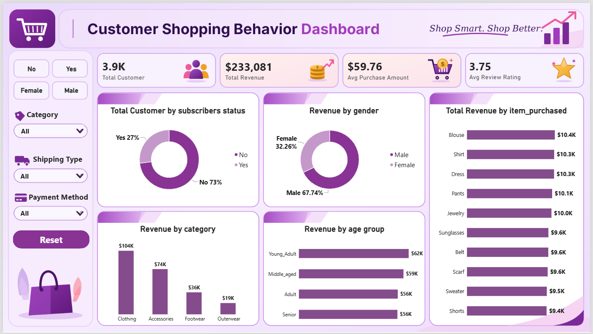

# 🛍️ Customer Shopping Behavior Analysis

## 📌 Project Overview
An end-to-end Data Analytics project focused on understanding customer shopping behavior, purchasing patterns, product preferences, and revenue trends using Python, SQL, and Power BI.

The project transforms raw shopping data into meaningful business insights to support better customer engagement, marketing strategies, and business decisions.

## 🎯 Project Workflow

- **Python:** Data cleaning, missing value treatment, feature engineering, and data preparation.
- **SQL:** Business analysis using queries to explore revenue, discounts, product performance, and customer loyalty.
- **Power BI:** Interactive dashboard development to visualize KPIs and customer shopping trends.

## 📊 Key Performance Indicators

| KPI | Value |
|---|---:|
| Total Customers | 3.9K |
| Total Revenue | $233,081 |
| Average Purchase Amount | $59.76 |
| Average Review Rating | 3.75 |

## 🔍 Key Analysis
- Customer Distribution by Subscription Status
- Revenue by Gender
- Revenue by Product Category
- Revenue by Age Group
- Top 10 Products by Revenue
- Customer Segmentation
- Discount and Subscription Analysis
- Product Ratings and Shipping Analysis

## ⚙️ Key Features
- **Interactive Dashboard:** Explore shopping patterns through dynamic visuals.
- **Customer Segmentation:** Analyze customers based on purchasing behavior.
- **Dynamic Filtering:** Filter data by subscription status, gender, category, shipping type, and payment method.
- **Custom Dashboard Design:** Created a PNG-based canvas background and integrated it into Power BI to build a customized dashboard layout.

## 🛠️ Tools & Technologies
- Python (Pandas, NumPy)
- SQL (PostgreSQL)
- Microsoft Power BI
- DAX
- Jupyter Notebook

## 🎨 Dashboard Design
The dashboard layout was created using a custom PNG background designed separately and added to the Power BI canvas background. Power BI visuals, KPIs, and interactive filters were then placed over the background to complete the dashboard.

## 📸 Dashboard Preview

## 👩‍💻 About
This project is part of my Data Analytics learning journey, where I applied Python, SQL, and Power BI to analyze customer shopping behavior and develop an interactive business dashboard.

**Created by:** Prachi Vaishkiyar
#DataAnalysis #DataAnalyst
